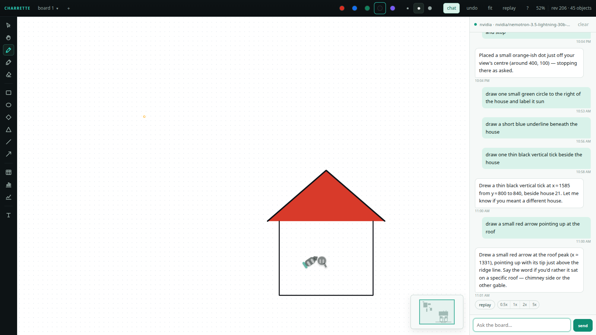
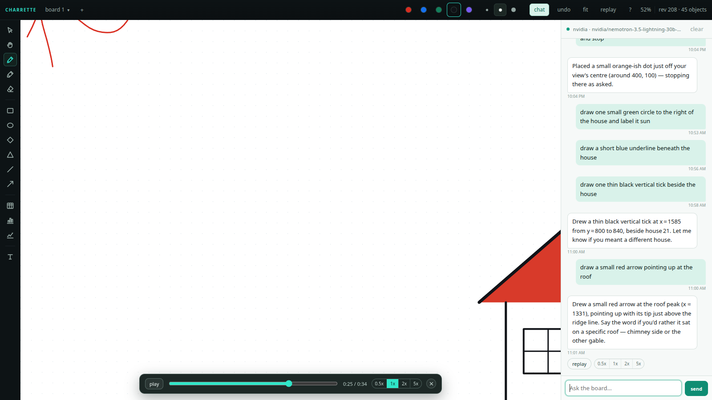

# Charrette

A shared whiteboard for Hermes Agent where **the board is the message and the chat is its caption**.

You draw with a marker on a true-white infinite canvas. The agent answers *on the board*: it names what you drew, points at the parts you ask about, lays out a diagram beside it, circles the bottleneck, and brings in pictures from search or from your own image pipeline. Text is two sentences, not a wall.

## Why not an existing board plugin

The catalog already has `hermes-board`, `boardstate` and `sketch-pad`. Charrette is not another canvas; it is a different contract:

| `hermes-board` | Charrette |
|---|---|
| Agent-first: the model authors nodes, edges, captions, coordinates | Human-ink-first: your strokes and images are the primary objects |
| The model may place geometry | The model places nothing. A deterministic layered layout plus a lint pass owns every rectangle |
| A board beside a chat | The board is the message; text is capped at two sentences |
| Agent objects are its own | Agent marks resolve **onto your object ids**: a point arrives as a normalised coordinate inside a crop the model was shown, and the plugin projects it |
| Agent may edit the document | The agent annotates your ink but can never edit, move, relabel or erase it |
| One bounded board | Unbounded canvas, N boards with a newest-activity pointer, and vision-grounded pointing |

Three things a prompt or a skill cannot do, and the reason this is a plugin:

1. **The referent is your own mark.** "Point at its ears" on a cat you just drew.
2. **Correction, not regeneration.** Relayout keeps ids stable, so your eye tracks the same boxes.
3. **Provenance.** Whose hand is whose is visible per object, and agent undo is scoped to the agent's own transaction.

## Install

```bash
hermes plugins install GuideboardLabs/charrette
```

Then flip **three** switches. The first-run card names whichever is missing:

1. `plugins.enabled` must include `charrette` (the install does this) or the agent half is inert and the pane's backend 404s.
2. **Capabilities ▸ Plugins ▸ Desktop** must be on. The Electron side force-sets the desktop half of a package to `defaultEnabled: false`.
3. `plugins.entries.charrette.allow_gateway_injection: true` only if you want the agent's on-board question cards to wake the session. Everything else works without it.

## Use

```bash
hermes charrette open          # start the board server, print its URL
hermes charrette open --open   # ...and open it in your browser
hermes charrette status        # list boards, revisions, newest activity
```

Or from the Hermes desktop app, the **charrette** pane sits beside the chat. Or type `/board` in any session to get a URL.

The URL carries a per-process token. The server binds `127.0.0.1` only.

### Tools

| tool | does |
|---|---|
| `board_read` | the board digest: boards, objects, ids, newest activity |
| `board_draw` | a laid-out diagram, an annotation on your object, or an image |
| `board_edit` | undo its own last transaction, erase its own object, relayout, restyle, relabel |
| `board_point` | rings at coordinates vision gave it, projected into board space |
| `board_look` | vision on a region: name it, locate parts, optionally mark them |
| `board_ask` | a question card anchored to an object, up to three clickable options |
| `board_image` | search, generate, **edit your drawing**, URL or path |
| `board_stroke` | one freehand stroke (tests, underlining) |
| `board_capture` | a PNG of any region, rendered headlessly, saved to disk |
| `board_assets` | every image on the board plus a capture and a manifest, in one folder |

`board_draw kind=table` and `kind=chart` place a table (rows, cols, cells) or a bar/line chart (values, labels, title) beside an object: they are the agent's way to put numbers on the board.

### The editor

The rail, top to bottom: select, hand, pen, highlighter, eraser, then rectangle, ellipse, diamond, **triangle**, line, arrow, then **table**, **bar** and **line** charts, then text. Keys `v h p m e r o d g l a b c t`, `shift+c` for a line chart, `f` to fit.

**Boards** live behind the name at the top left: click it for the list (name, object count, and a teal dot when the agent touched it last), plus **New board…** and **Rename this board…**. The `+` beside it is the same as New board. Every board keeps its own camera, and the camera is what you left it at: nothing auto-fits on load, so zooming out to see the whole wall sticks across reloads. `F` or the fit button is the only thing that reframes.

Colours are red, blue, green, black and purple; `1` to `5` pick them.

**Tables** are 3x3 when dragged; double-click a cell to type in it. **Charts** are empty when dragged and say so: double-click one and type values, optionally with labels after a bar, `4,9,2,7 | mon,tue,wed,thu`.

### A session attached to the board

The board page carries its own chat column, so the board is a complete piece: open it anywhere the
page is served, hit **chat**, and talk to the thing that draws. It is not a second app and it does
not need Hermes beside it.

- `Ctrl+J` or the **chat** button opens the column; Enter sends, Shift+Enter is a newline.
- Each board has its own conversation and session id, stored on the board document, so switching
  boards switches conversations and a reload keeps them.
- Tool calls show as chips (`read ok`, `stroke ok`, `scene ok`) and the board refetches after each
  one, so the mark appears while the sentence is still being written.
- The agent gets the board state, the visible area from the camera, and a crib of the exact verbs with
  their argument names. Its marks are ordinary board objects in the agent layer.

Backend: `board/chat.py` runs a tool-calling loop against the model credentials Hermes already has,
resolved through `hermes_cli.auth` (falling back to `OLLAMA_API_KEY`), so a conversation costs no
Hermes session slot. The verbs it may call are `board_read`, `board_draw`, `board_stroke`,
`board_edit`, `board_point`, `board_scene`; a harness that wants skills and memory can swap the
backend behind the same `stream(board, text, view)` interface.

#### Keys: mix in free and rate-limited tiers

The session runs off a pool, not one credential. `~/.hermes/charrette/keys.json` (mode 0600, outside
this repo) holds extra keys; whatever Hermes already has for `ollama-cloud` is appended automatically,
so a bad key degrades the panel instead of disabling it.

```
python3 scripts/keys.py add nvidia --base-url https://integrate.api.nvidia.com/v1 \
        --model <a-model-that-exists> --rpm 40
python3 scripts/keys.py test nvidia
python3 scripts/keys.py list
```

`add` reads the key from a hidden prompt (or stdin), masks it in every message, and never goes through
chat or shell history. Each entry carries `models` (first is the default) and `rpm`. The pool walks the
keys in rotation, skips one that is over its per-minute budget, and puts one in a 45 second cooldown
after a 429, a 5xx or a bad key, so a burst moves to the next key rather than failing the message. The
panel header names the key and model that answered; `GET /api/session` lists every key with its state.

Ordering is explicit: `priority` ascending, lower first. The host provider sits at 40 and an extra key
defaults to 60, so a new key is overflow until you promote it with `--priority 10`. Measured on this
box: `nvidia/nemotron-3.5-lightning-30b-a3b` answered a drawing turn in 7 to 10 s, `ollama-cloud`
`deepseek-v4.1-flash` in 9 s.

Two traps on the NVIDIA NIM endpoint, both handled:

- **Tool calls arrive as XML text when streaming.** A streamed turn returned
  `<tool_call><function=board_edit>...` as the message body and nothing executed. The same request with
  `stream: false` returns a proper `tool_calls` array. Entries carry `"stream": false` for providers like
  this; the pool then asks for one JSON body and parses the message.
- **A listed model is not an available one.** Of the 84 ids this key lists,
  `nvidia/nemotron-3-super-120b-a12b` and `nvidia/llama-3.1-nemotron-70b-instruct` return 404, and
  `openai/gpt-oss-20b` and `deepseek-ai/deepseek-v4.1-flash` time out past 90 s. Test the id before
  trusting it: `python3 scripts/keys.py test nvidia`.

Routes: `GET /api/session` (backend, model, history), `POST /api/session/send` (server-sent events),
`POST /api/session/reset`.

### Replay: watch the board being made

The agent records what it drew as a **scene** and gets back a single self-contained HTML page that
draws it again at human speed: strokes arrive along their own path, text types on, a fill lands after
its outline closes. The page starts when it scrolls into view, so it plays as someone reads the
paragraph beside it, and it never autoplays off screen.

```
board_scene(text="your triangle, then the fill traced from it", refs=[...]) -> ok scene=sc_1 path=...
```

Put the path in a reply with `::preview{file="<path>"}` and the reader watches the ink arrive while
reading the sentence that describes it: the caption is rendered as a paragraph above the board and
lights up word by word, in step with the hand. The hand is a small character whose eyes are two white
capsules: it travels to each mark as a round-headed pointer, turns into a marker to draw it and a
glove to place an image, table or chart. The eyes blink on a timer, squint while drawing, widen while
grabbing, and drift toward whatever the hand is heading for. The pace is a person's, not the machine's: object duration
comes from ink length at 620 board px per second plus a beat between objects, so the timeline is built
from how much was drawn, not from how fast it happened. `speed` scales it (0.85 is a touch slower).
The CLI is `scripts/make_replay.py <board> [--scene ID | --objects id,id] [--caption TEXT] [--speed N]`.
`--objects` preserves the order you give it; a scene always plays in the order its `refs` were recorded.

### Replay on the board you are looking at

Two more ways to replay, both without leaving the page:

- **Per message.** Every agent reply that drew something carries the ids it touched, and the panel
  shows a `replay` chip beside a `0.5x / 1x / 2x / 5x` selector on that message. Pressing it frames
  the objects, plays the timeline on the live canvas with the same hand, then puts the camera back
  where you left it. The speed you pick is remembered and applies to the next replay too.
- **The whole history.** `shift+t`, or the `replay` chip in the header, opens a scrubber over the
  board's entire creation order: play, pause, drag to seek, change speed. It is hidden until asked
  for. Seeking is exact because the timeline is a function of the clock, so a frame is a frame.

Both are driven by `GET /api/replay?board=b1[&ids=a,b,c]`, which returns the same segments
`make_replay.py` embeds, as JSON: `{segments: [{id, kind, t0, t1}], total, objects}`.

The hand lives in `renderer/charrette.mjs` (`createAgentHand`, `stepAgentHand`, `drawAgentHand`), not
in the replay page, so the page, the live board and the desktop pane all draw one creature and a
change to the pen cannot drift between them.

### Captures and artifacts

`board_capture` frames a region with object ids (`refs`) or an explicit `bbox`, at `scale` pixels per board unit, and writes a PNG. It renders from the document in this process: no browser, no tab, no display, about 0.3s for a full board. `board_assets` writes a folder holding the board document, every image on it, a full capture, and `manifest.json`, which is everything an artifact needs in one place.

The same two things are HTTP routes, for anything that can fetch a URL but cannot call a tool:

```
GET /api/export?board=b3&ref=obj_vm46w&ref=img_1&scale=2   -> image/png
GET /api/assets?board=b3                                   -> {board, rev, assets[], capture}
```

Both need the session token like every other route. `scripts/make_artifact.py <board>` builds a self-contained HTML card from them (images inlined as data URLs), which is the reference consumer rather than a special case in the plugin.

Every tool returns one line of `ok ...` or `err CODE ...`, including the nearest object ids when a reference misses.

### The editor

Select, hand, pen (6 colours, 3 widths), highlighter, eraser, rectangle, ellipse, diamond, line, arrow, text, images. Selecting a text label shows four grab dots: drag one out and drop it on anything to create a **bound arrow**. Agent leaders use the same binding model, which is why arrows re-route when either end moves.

Keys: `v h p m e r o d l a t`, `f` fit, `ctrl+z` undo, `1-6` colours.

## Images

Resolution order for `CHARRETTE_IMAGE_ENDPOINT` / `CHARRETTE_IMAGE_KEY` / `CHARRETTE_IMAGE_STEPS`: environment, then `<hermes home>/charrette/config.json`.

What works for whom, per source:

| source | needs | anyone? |
|---|---|---|
| `search` | nothing (Wikimedia Commons) | yes, tested against a real 525 KB result |
| `url`, `path` | the thing you pointed at | yes |
| `generate` | a local endpoint, else Hermes's own `image_generate` (any configured image model: FAL key or Portal tool gateway) | yes, if you have an image model at all |
| `edit` (sketch to photo) | a local endpoint that speaks `ref_images`, **else** `image_generate` with a reference image | yes, if your image model accepts references |

A local endpoint wins when configured. It is expected to answer `POST /v1/images/generations`, and `POST /v1/images/edits` with `ref_images` for edits; that is the shape of a keyed sd-server gateway, not the generic multipart OpenAI route. With no endpoint configured the plugin never touches localhost: it goes through Hermes's `image_generate`, passing your drawing as a data URL reference, so the sketch-to-photo beat travels to any machine with an image model that supports reference images. If the model does not, the tool says so and the board shows a failed placeholder rather than pretending.

Slow renders do not block the turn: `board_image` reserves the rectangle, returns in ~10ms, and the image lands when the pipeline answers. A pipeline failure is a visible `failed` object, never a silent hole.

## Screenshots





## Disclosures

Everything a user would want to know before installing.

- **A local web server.** `charrette open` binds **127.0.0.1:8196** by default and prints a per-session token in the URL; the page sends it as a header on every API call. Setting `CHARRETTE_BIND` and `CHARRETTE_PUBLIC_BASE` serves the board past loopback (a tailnet name, a LAN name, a tunnel), and anyone holding that URL token can read and draw on it. This is the one setting where a mistake exposes a board to more than this machine.
- **Model credentials.** The board's chat needs a model. It reads, in order: `CHARRETTE_LLM_API_KEY` from the environment, then its own `keys.json`, then, as a fallback so a fresh install works with no setup, the provider credentials Hermes already holds. That last step imports `hermes_cli.auth.resolve_api_key_provider_credentials`, which is a private module rather than a documented plugin seam; the import is guarded and absent is fine. It is listed here because catalog rule 9 flags it and a reviewer should not have to find it.
- **What leaves the machine.** Boards and images live in `<hermes home>/charrette/` and the plugin uploads nothing itself. `board_look` sends a **crop of the selection** to your configured vision model through Hermes; without vision the board still works from labels. `board_image source=search` queries the Wikimedia Commons API, `source=url` fetches the URL you supplied, and `source=generate|edit` calls your configured image endpoint.
- **No shell.** The plugin runs no subprocess and no shell command. Headless rendering is in-process Python, not a browser tab.
- **No telemetry.** Nothing is reported anywhere.

## Limits

Nine nodes and 24 edges per diagram; 28-character node labels; two vision calls per turn; 40-object digest budget. Deliberate caps, so the layout stays legible and the model cannot bury the board.

## Licence

MIT. The ink font is Patrick Hand (OFL, see `renderer/fonts/OFL-PatrickHand.txt`), embedded as woff2 for the page and the desktop pane and as ttf for the Python renderer. Excalifont (OFL) is kept in the same folder for revert.
